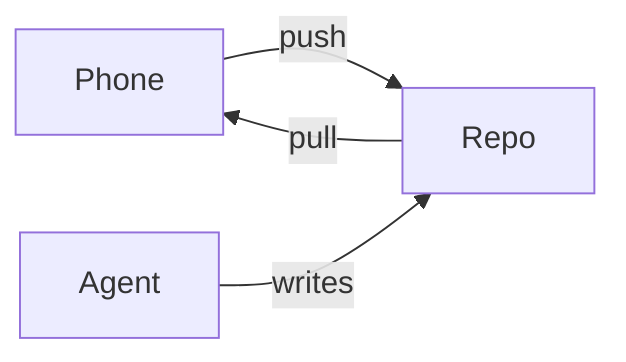

# 04 · Code and diagrams

DuoNotes can show more than ordinary notes. An agent might send a small code sample to review, or a diagram explaining a workflow. You don't need to know how to code to view them.

**Code example:** the block below is a tiny Swift function. Tap it for **View Code** or **Copy**.

```swift
func greet(_ name: String) -> String {
    "Hello, \(name)"
}
```

**Diagram example:** this Mermaid block explains how your phone, GitHub, and an agent exchange changes. Tap **View Diagram**.



**Try it:** open the diagram, then follow the arrows. You can also find a standalone diagram in **07 Sync flow.mmd**.
